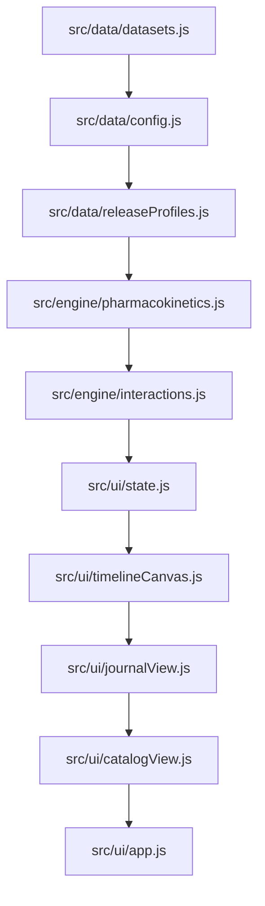

# 🧠 Synaptik Journal — Documentation Technique & Guide Développeur (Architecture & Moteurs)

## 📌 1. Vue d'ensemble du Projet

Synaptik Journal est un outil de suivi pharmacocinétique et d'évaluation des risques médicamenteux. Il se compose de deux volets :
1. **Le Simulateur Web (`simulateur_synaptik.html` + `src/`)** :
   - Interface interactive haute fidélité (look & feel mobile).
   - Fonctionne **100 % hors-ligne** (chargement direct par double-clic via protocole `file://` ou serveur local `http://`).
   - Moteur de rendu Canvas 2D temps réel affichant les courbes de concentration / effet plasmatique.
   - Système de simulation accélérée (x60), vérification des interactions croisées et détection des paliers de doses.
2. **L'Application Native Android (`psychonautwiki-journal-android-main/`)** :
   - Application native Android (Jetpack Compose, Kotlin, Room DB).
   - Partage les mêmes datasets cliniques JSON et la même logique de modélisation galénique (matrices LI/LP).

---

## 📁 2. Arborescence & Rôles des Fichiers

```text
synaptik journal/
│
├── simulateur_synaptik.html        # Point d'entrée Web (497 lignes, HTML sémantique sans logique lourde)
│
├── src/                            # Code source modulaire du simulateur
│   ├── css/
│   │   └── simulator.css           # Châssis mobile (.phone-frame), scrollbars, animations
│   │
│   ├── data/
│   │   ├── datasets.js             # Base DATASETS (FR/EN) : 416 substances (dont 55 métabolites actifs qualifiés ≥ 5%), 30 catégories
│   │   ├── config.js               # I18N, CATEGORY_CONFIG, ROA_NORM_CONFIG, NON_DIVERTIBLE_DOSES
│   │   ├── releaseProfiles.js      # Catalogue galénique RELEASE_PROFILES_CATALOG (classé en 7 familles)
│   │   └── metabolicPathways.js    # Base pharmacogénomique : 23 enzymes/transporteurs, 11 classes de récepteurs, fractions fm/fe & liens activeMetabolites
│   │
│   ├── engine/
│   │   ├── pharmacokinetics.js     # Moteur mathématique : courbes C1 biphasiques, queues/rebonds de métabolites actifs, puissance, paliers
│   │   ├── pharmacogenomics.js     # Moteur de personnalisation : étalonnage empirique, CKD-EPI 2021, compétition enzymatique, charge métabolique active
│   │   └── interactions.js         # Moteur bidirectionnel d'interactions médicamenteuses & règles RdR Mère/Métabolite multi-jours
│   │
│   └── ui/
│       ├── state.js                # État global, lookup O(1), horloge et contrôleur temporel x60
│       ├── timelineCanvas.js       # Rendu Canvas 2D (Timeline principale + Modale théorique) & gestes
│       ├── journalView.js          # Contrôleur Onglet Journal (Quick Log, validation sécurité, historique)
│       ├── catalogView.js          # Contrôleur Onglet Catalogue (recherche, filtres) & Modale Molécule
│       └── app.js                  # Orchestrateur central (navigation, langues FR/EN, init)
│
└── psychonautwiki-journal-android-main/.../
    └── ReleaseProfile.kt           # Modélisation Kotlin des profils galéniques (7 familles thérapeutiques)
```

---

## ⚙️ 3. Ordre d'Exécution & Dépendances Script

Dans `simulateur_synaptik.html`, les scripts sont importés dans l'ordre strict de leurs dépendances afin d'éviter tout bundleur/transpileur (fonctionne nativement sous n'importe quel navigateur) :



---

## 🔬 4. Principes Mathématiques & Pharmacocinétiques

### A. Modélisation de la courbe plasmatique ($C^1$ continue)
Contrairement aux simples polygones linéaires, la cinétique d'une onde est modélisée par des fonctions trigonométriques $C^1$ sans discontinuité de dérivée :
- **Phase de montée (Onset + Comeup) :**
  $$f(\tau) = \sin^2\left(\frac{\pi}{2} \tau\right), \quad \tau = \frac{\Delta t - t_{\text{onset}}}{t_{\text{rise}}}$$
- **Plateau thérapeutique (Peak / Plateau) :**
  Oscillation douce pour simuler la saturation enzymatique :
  $$f(\tau) = 1.0 + 0.035 \cdot \sin(\pi \tau)$$
- **Phase d'élimination (Offset / Clearance) :**
  $$f(\tau) = \cos^2\left(\frac{\pi}{2} \tau\right)$$

Fonction clé : `evalSmoothWave(dtWave, wv, baseOnsetMin, baseRiseMin, baseFallMin)` dans [`src/engine/pharmacokinetics.js`](file:///c:/Users/droll/Desktop/synaptik%20journal/src/engine/pharmacokinetics.js#L126).

### B. Indice de Puissance & Réponse Sigmoïde
- **Potency Index** : Les molécules très puissantes (ex. Fentanyl, Buprenorphine, Clonazepam) ont des doses actives de l'ordre du microgramme ou du milligramme faible. L'indice normalise cela pour adapter la hauteur des vagues sur le graphique.
- **Réponse Dose-Effet Sigmoïde** :
  Calculée par `computeTierResponse(dose, d)` pour éviter qu'une surdose n'explose visuellement le canvas à l'infini tout en traduisant fidèlement la saturation des récepteurs.

### C. Profils Galéniques Décomposés (LI vs LP / OROS / XR)
Une prise à libération prolongée n'est pas une simple boîte étirée : elle est décomposée en **ondes élémentaires pondérées** (`waves`) :
- **Exemple OxyContin LP 12h** : 48% immédiat en surface ($\text{stretch} = 0.9$) + 52% matriciel retardé de 30 min ($\text{stretch} = 2.4$, plateau de 7.5h).
- **Exemple Concerta LP OROS** : 22% enrobage immédiat + 78% délivrés régulièrement par la pompe osmotique.

### D. Moteur Pharmacogénomique, Rénal (CKD-EPI 2021), Étalonnage Empirique & Tolérance
Implémenté dans [`src/data/metabolicPathways.js`](file:///c:/Users/droll/Desktop/synaptik%20journal/src/data/metabolicPathways.js) et [`src/engine/pharmacogenomics.js`](file:///c:/Users/droll/Desktop/synaptik%20journal/src/engine/pharmacogenomics.js) :
1. **Clairance Multi-Voies (Hépatique + Rénale)** :
   Pour toute molécule $M$ dont les fractions d'élimination scientifiquement connues sont $f_{m,i}$ (enzymes CYP450, UGT, CES1, MAO, etc.) et $f_{e,\text{renal}}$ (`RENAL_GFR`, `RENAL_OAT`, `RENAL_OCT2`) :
   $$CL_{\text{rel}}(M, t) = \left(1 - \sum_{i} f_{m,i}\right) + \sum_{i} f_{m,i} \cdot \frac{V_{\text{eff}}(E_i)}{I_{\text{comp}}(E_i, t)}$$
   Le facteur d'étirement de la durée d'élimination est $S_{\text{dur}}(M) = \frac{1}{CL_{\text{rel}}(M, t)}$.
2. **Étalonnage Empirique & Propagation Croisée** :
   Lorsqu'un utilisateur renseigne la durée réelle observée $D_{\text{obs}}(A)$ d'une molécule étalon $A$ (ex. Oxycodone = $3\text{h}$ au lieu de $D_{\text{std}} = 5\text{h}$), le moteur infère la vitesse de chaque enzyme impliquée selon sa part métabolique :
   $$\Delta V(E_i) = \left(\frac{D_{\text{std}}(A)}{D_{\text{obs}}(A)} - 1\right) \cdot \frac{f_{m,i}(A)}{\max\left(0.22, \sum_k f_{m,k}(A)^2\right)}$$
   Toutes les autres molécules partageant totalement ou partiellement ces mêmes enzymes voient leur durée automatiquement recalculée.
3. **Fonction Rénale & Créatinine Sanguine (Équation Officielle CKD-EPI 2021)** :
   Convertit la créatinine sérique ($\mu\text{mol/L}$ ou $\text{mg/dL}$, âge, sexe) en $\text{DFG estimé}$ ($\text{mL/min}/1.73\text{m}^2$) et adapte les molécules à élimination rénale (ex. Prégabaline 98% rénale, Gabapentine 100%, Lithium 95%, Baclofène 80%).
4. **Compétition Enzymatique & Tubulaire Rénale (Michaelis-Menten)** :
   $$I_{\text{comp}}(E_i, t) = 1 + \sum_{B \neq A} \left( \kappa_{\text{inhib}}(B, E_i)\cdot C_B(t) + \kappa_{\text{sub}}\cdot f_{m,i}(B)\cdot f_{m,i}(A)\cdot C_B(t) \right)$$
5. **Tolérance Dynamique aux Récepteurs** :
   Décroissance exponentielle selon la constante de resensibilisation $\tau_{\text{rec}}(R)$ propre à chacune des 11 classes de récepteurs et loi de saturation de Hill sur l'amplitude $A_{\text{eff}}(t)$.
7. **Modèle Biphasique $C^1$ & Queues / Rebonds de Métabolites Actifs ($\ge 5\%$ steady-state)** :
   - **Critère scientifique d'inclusion** : Seuls les métabolites actifs dont l'exposition/activité à l'équilibre ($R_{\text{act}} = f_{\text{conv}} \cdot P_{\text{rel}} \cdot \frac{t_{1/2,\text{met}}}{t_{1/2,\text{parent}}}$) atteint ou dépasse $5\%$ de la molécule mère sont modélisés (55 métabolites actifs au total dans `datasets.js` sans aucun doublon : 27 existants enrichis + 28 nouveaux).
   - **Séparation stricte Durée Ressentie vs Queue Métabolique** : L'étalonnage empirique à jeun ajuste `perceivedDurationMin` (phase aiguë ressentie), tandis que `metaboliteTailEndMin` modélise la décroissance plasmatique réelle du métabolite actif sur $24\text{h}\text{--}96\text{h}+$ (ex. `Diazepam` $\to$ `Nordiazepam`, `Tramadol` $\to$ `O-Desmethyltramadol`, `Fluoxetine` $\to$ `Norfluoxetine`).
   - **Modulation génétique & rénale de la queue** : L'amplitude et le délai du métabolite actif dépendent de la vitesse de l'enzyme de formation (ex. `CYP2D6` lent vs ultrarapide sur `Codeine` $\to$ `Morphine` ou `Tramadol` $\to$ `O-DSMT`) et de la clairance rénale CKD-EPI 2021 (ex. accumulation de `Morphine-6-glucuronide` en insuffisance rénale).
   - **Rendu Canvas 2D épuré** : Une seule courbe composite $C^1$ par molécule ingérée, fenêtre par défaut centrée sur $\sim 24\text{h}$ avec boutons rapides `12h` / `24h` / `72h`, repère discret de transition `↳ Métabolite` et distinction `⏱ ~Xh ressenti` vs `🧬 métabolite actif ~Yh (RdR)`.

---

## 🛡️ 5. Moteur d'Interactions & Règles RdR Mère / Métabolite Actif

Le fichier [`src/engine/interactions.js`](file:///c:/Users/droll/Desktop/synaptik%20journal/src/engine/interactions.js) teste les interactions dans les deux sens ($A \to B$ et $B \to A$) :
1. **Correspondance nominale directe** (ex. `Oxycodone` $\leftrightarrow$ `Alprazolam`).
2. **Correspondance par classe** via `IMPLICIT_INTERACTION_CATS` (ex. `Depressant`, `Opioid`, `Benzodiazepine`, `SSRI`, `MAOI`).
3. **Trois règles strictes pour les métabolites actifs** :
   - **Règle 1 (Pas d'auto-alerte Mère $\leftrightarrow$ Métabolite endogène)** : Aucune alerte n'est déclenchée entre une molécule mère et son métabolite issu du métabolisme (`endogenousConversion`). En revanche, si l'utilisateur enregistre volontairement les deux en prise directe (`source: 'user_intake'`, ex. `O-Desmethyltramadol` RC + `Tramadol`, ou `Oxazepam` + `Diazepam`), une alerte explicite de double exposition / surdosage est générée.
   - **Règle 2 (Non-redondance & Rehaussement via Métabolite)** : Si la molécule mère possède déjà une interaction de gravité égale ou supérieure avec une substance $B$, aucune alerte redondante n'est ajoutée. Si seule la voie du métabolite actif déclenche ou aggrave le risque (ex. `Carbamazepine` $\to$ `Carbamazepine-10,11-epoxide` + `Valproate`, inhibition d'époxyde hydrolase), l'alerte est rehaussée avec mention explicite `via son métabolite actif [Nom]`.
   - **Règle 3 (Persistance multi-jours J-1 à J-7)** : `evaluatePreIngestionInteractions` interroge `getActiveMetaboliteLoadAt` sur l'historique multi-jours (`journalDaysHistory`) et alerte l'utilisateur lorsqu'un métabolite actif à longue demi-vie issu d'une prise des jours précédents est encore $\ge 5\%$ dans l'organisme (ex. `Diazepam` pris à J-2 $\to$ `Nordiazepam` actif lors d'une prise d'`Oxycodone` à J0).

---

## 📱 6. Équivalence Android Native (`ReleaseProfile.kt`)

Dans l'application Android ([`ReleaseProfile.kt`](file:///c:/Users/droll/Desktop/synaptik%20journal/psychonautwiki-journal-android-main/psychonautwiki-journal-android-main/app/src/main/java/com/isaakhanimann/journal/data/substances/classes/roa/ReleaseProfile.kt)) :
- La classe `ReleaseProfileCatalog` applique exactement les mêmes paramètres que `src/data/releaseProfiles.js`.
- Les formulations sont structurées en 7 catégories identiques et réutilisent les constructeurs d'ondes factorisés :
  - `immediateVariant(...)`
  - `matrixWaves12h(firstStretch, secondStretch, plateauHours)`
  - `matrixWaves24h(secondStretch, plateauHours)`

---

## 🚀 7. Bonnes Pratiques pour Reprendre ou Modifier le Code

1. **Ajouter une nouvelle molécule ou forme LP** :
   - Déclarer son profil dans [`src/data/releaseProfiles.js`](file:///c:/Users/droll/Desktop/synaptik%20journal/src/data/releaseProfiles.js) sous la classe thérapeutique appropriée.
   - Si besoin, reporter dans [`ReleaseProfile.kt`](file:///c:/Users/droll/Desktop/synaptik%20journal/psychonautwiki-journal-android-main/psychonautwiki-journal-android-main/app/src/main/java/com/isaakhanimann/journal/data/substances/classes/roa/ReleaseProfile.kt).
2. **Performance du Canvas (60 fps)** :
   - Ne **jamais** allouer de nouveaux objets ou recalculer des expressions régulières à l'intérieur de la boucle `drawTimeline()`.
   - Utiliser `RGB_CACHE` et les lookups pré-indexés `SUBSTANCES_BY_NAME`.
3. **Tests & Validation Rapide** :
   - Un script de validation automatique est présent dans le projet. Vous pouvez valider l'intégrité de la syntaxe et des liaisons DOM à tout moment avec :
   ```bash
   node scratch/verify_modular_app.js
   ```

